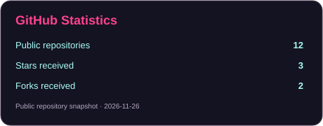

<h1 align="center">Hi, I'm Arwa Boudarfa</h1>
<h3 align="center">Engineering Student · Cybersecurity & Cloud Computing · ENSAM Casablanca</h3>

  

---

- 🎓 **2nd-year engineering cycle** — Cybersecurity & Cloud Computing, ENSAM Casablanca
- 🐛 **Vulnerability Research & Bug Bounty** — web application security research and responsible vulnerability reporting
- 🛡️ **GRC Trainee @ CybrForge** — client work across ISO 27001/27005, NIST RMF, DORA, and Moroccan Loi 05-20; built a full M365 security posture assessment and risk register
- 🏆 **CTF** — MACC 2026 (national, AI/LLM prompt injection track) · CITEFLAG Digital Forensics **15/15**
- 🔬 Currently building: **Offense/Defense Lab** (Proxmox + OPNsense, red/blue team practice)
- 🌱 Exploring: **Cloud Security · LLM Security · Malware Analysis · OT/ICS**
- 📫 Reach me: [LinkedIn](https://www.linkedin.com/in/arwa-boudarfa/) · arwaboudarfa91@gmail.com

---
## 🏅 Certifications

- ✅ **Fortinet NSE 4** — FortiOS 7.6 Administrator
- ✅ **Fortinet NSE 5** — FortiAnalyzer 7.6 Analyst
- 📚 **In preparation:** Fortinet **SD-WAN 7.6 Core Administrator**
- 📚 **In preparation:** AWS **Cloud Practitioner**

---

## 🛠️ Tech Stack

**Security & SOC**

**GRC & Standards**

**Languages & Frameworks**

**ML & Data**

**Infrastructure & Cloud**

---

## 📂 Projects

### 🔴 Offensive Security & Bug Bounty
- **[ethical-hacking-demo](https://github.com/ARWA044/ethical-hacking-demo)** — Documented offensive security techniques for learning purposes (Python).
- **OWASP Juice Shop** *(in progress)* — Working through Juice Shop's vulnerability challenges, including LLM prompt-injection scenarios, via Burp Suite on Kali Linux.

### 🔵 Detection & Threat Intelligence
- **[AI Security Guard](https://github.com/ARWA044/AI-security-guard)** — Isolation Forest behavioral anomaly detection and interactive risk analysis on simulated access logs.
- **[cybersecurity-intrusion-detection](https://github.com/ARWA044/cybersecurity-intrusion-detection)** — Experimental IDS with Streamlit; Random Forest, XGBoost, Logistic Regression and Autoencoder.
- **[arp-spoofing-detection](https://github.com/ARWA044/arp-spoofing-detection)** — ML-based ARP spoofing detection experiments on network traffic datasets.
- **[mini-siem-cy01](https://github.com/ARWA044/mini-siem-cy01)** — DFA engine in JavaScript detecting multi-step attack sequences (auth_fail → port_scan → privilege_escalation); pipeline: webhook → Google Sheets → Slack & WhatsApp alerts via Twilio.
- **SSH Honeypot – Threat Intelligence Pipeline** *(in progress)* — Hardened Cowrie in Docker (cap-drop ALL); JSON logs ingested into Splunk with SPL correlation queries.

### 🛡️ GRC & Compliance
- **M365 Security Posture Assessment** *(client work CybrForge)* — 50-page assessment aligned to ISO 27001:2022: licensing analysis, risk register, and remediation roadmap (Conditional Access, phishing-resistant MFA, SPF/DKIM/DMARC sequencing).

### 🏗️ Infrastructure & Labs
- **[LunarOps](https://github.com/ARWA044/LunarOps)** — NASA Space Apps team prototype; my contribution: Docker, Terraform, AWS and DevSecOps. [CI pipeline](https://github.com/ARWA044/LunarOps/actions/runs/43748465914).
- **Offense/Defense Lab** *(in progress)* — Self-hosted Proxmox + OPNsense environment for red/blue team practice; writeup coming as it matures.

### 🏆 CTF & Competitions
- **MACC 2026** (Morocco Academia Cyber Competition — DGSSI & SecDojo) — AI/LLM track: prompt injection on LLM → extracted MCP Bearer token → read privileged system file.
- **CTF CITEFLAG — Operation GLASSWORM** — Score **15/15**. Disk image forensics, malicious npm extraction, Splunk log correlation: timestomping (T1070.006), C2 exfiltration via Solana Devnet.

### ⚙️ Applied Engineering & AI
- **[ECU-BMS Project](https://github.com/ARWA044/ECU-BMS-Project)** — Simulated battery diagnostics; my contribution: machine learning, measurement-limit rules and diagnostic JSON.

### 💻 Web Applications
- **[finance-tracker](https://github.com/ARWA044/finance-tracker)** — Django personal finance tracker with Plotly expense visualizations.
- **[weather-app](https://github.com/ARWA044/weather-app)** — Flask + HTML/CSS weather application.

---

## 📈 GitHub Stats

  

[View contribution activity](https://github.com/ARWA044#contribution-activity)

---

## 🤝 Let's Connect

  
  

